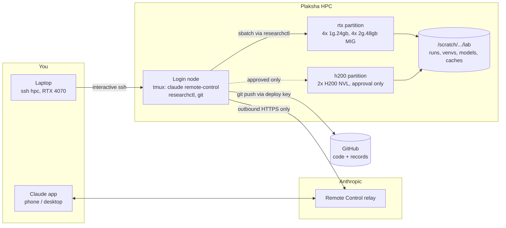

# Architecture



## Decisions

| Decision | Choice | Why |
|---|---|---|
| Where the agent runs | Login node, in tmux | The cluster allows outbound HTTPS and TCP 22, so the agent can sit next to Slurm and scratch with no inbound exposure. IT approved. |
| How you reach it | Claude Code Remote Control | Outbound-only. Works from phone or desktop. Your laptop does not need to be on or on campus. |
| AWS EC2 + reverse tunnel | Not used | Unnecessary given outbound access. Adds cost, a fragile laptop dependency, and an off-campus route into the cluster. |
| MCP servers | Not used | A CLI returning compact JSON does the same job with fewer tool definitions in context and no extra service. |
| Experiment tracking | Experiment records in git plus files on scratch | Durable, diffable, independent of any service. MLflow/W&B add a server or an external dependency for little gain at this scale. |
| Environments | Three uv projects (`envs/research`, `envs/interp`, `envs/kernels`), venvs on scratch | Locked, reproducible, fast to rebuild. The cluster has no CUDA module; the PyTorch cu128 wheels bring their own runtime. `kernels` adds nvcc via pip. |
| Accounts | Your account only | The IT staff accounts (hpc2, hpc3) are not used by the agent. Mixing identities would muddy accounting, the H200 budget, and the audit trail. |

## Enforcement layers

1. **Hooks** (`.claude/hooks/guard.py`). Raw Slurm calls, H200 partitions, secret reads, edits to
   read-only models or approvals, and force pushes are denied. Recursive deletes, history rewrites,
   approvals and edits to the guards themselves need your confirmation in the app.
2. **researchctl gates**. A confirmatory run requires a committed preregistration, at least 3 seeds,
   a clean tree, pinned model and data revisions, the literature/reproduction/gap artifacts, and a
   one-time-only test split. Duplicate configs are refused. Over 48 GPU-hours needs a written reason.
   H200 needs an approval bound to the exact config hash and GPU-hours.
3. **The claims checker**. Verdicts come from recomputed statistics (paired/Welch t, Holm). Edited
   preregistrations invalidate claims. Excluded seeds are surfaced. Wording is linted. Papers take
   numbers only from generated macros.
4. **The red-team subagent**. A fresh context attacks every claim and searches for prior work.
5. **The filesystem**. Model snapshots are `chmod a-w`. Each job runs from an immutable `git archive`
   of its commit.
6. **Audit**. `researchctl budget`/`doctor` list every H200 allocation from `sacct` and flag any
   without an approval record.

Limits: the hooks catch accidents and drift, not a deliberately adversarial agent (it could, for
example, call Slurm from inside a Python script). The after-the-fact audit is the backstop.

## Data layout

```
repo (git)                         $LAB_ROOT = /scratch/<user>/lab (not in git)
projects/<p>/PROJECT.md            runs/<exp_id>/code/          immutable code snapshot
            lit/cards/*.yaml            runs/<exp_id>/NNN/       params, manifest, metrics, summary, ckpt
            repro/<paper>/REPORT.md     venvs/{research,interp,kernels}
            gaps.md                     models/<id>@<sha>/       read-only snapshots
            prereg/H###.yaml            cache/{hf,uv,papers}
            configs/*.yaml              approvals/{requests,approved,consumed}
            experiments/<exp_id>.yaml   (record: config, git sha, jobs, per-task results)
            claims.yaml, claims.lock.json
            paper/
```
